<div align="center">


# ERMES 20.0.5

**E**lectric **R**egularized **M**axwell's **E**quations with **S**ingularities

*Open-source finite element tool for computational electromagnetics in the frequency domain*

[](#license)


[Overview](#overview) •
[What's new](#whats-new) •
[Features](#features) •
[Package contents](#package-contents) •
[Installation](#installation) •
[PETSc](#petsc) •
[Workflow](#workflow) •
[Gallery](#gallery) •
[Citation](#citation) •
[Publications](#publications) •
[Previous versions](#previous-versions) •
[Contact](#contact)

</div>

---

<a id="overview"></a>

## 🔭 Overview

ERMES is an open-source C++ finite element (FEM) code that solves Maxwell's equations in the frequency domain. Version 20.0 was a major upgrade, adding new modules, FEM formulations and HPC capabilities aimed at the demanding electromagnetic problems found in the design and analysis of nuclear fusion reactors. Version **20.0.5** adds an internal parallel direct solver, corrects several bugs and makes ERMES easier to build and install ( see [What's new](#whats-new) ).

ERMES works across the **static, quasi-static and high-frequency** regimes. It has been applied to microwave engineering, bioelectromagnetics, electromagnetic compatibility and electromagnetic forming, and, through its electrostatic and cold-plasma modules, to fusion problems such as plasma disruption induced currents and forces, plasma control, electric-arc initiation, and wave–plasma–wall interaction.

The graphical user interface is fully integrated into the pre/post-processor **[GiD](https://www.gidsimulation.com)**, which handles geometry, data input, meshing, and visualisation. GiD is the recommended option for setting up simulations and post-processing results, but it is not required. Any pre-processor can be used, provided that it generates the ERMES input files in the format described in the manual.

---

<a id="whats-new"></a>

## 🆕 What's new in 20.0.5

- **Internal direct solver** — parallel ( OpenMP ) supernodal multifrontal factorization with **METIS** nested dissection ordering, pivoting and GMRES refinement. Robust where iterative solvers struggle ( resonances, low losses, high-contrast materials, low-frequency A–V formulations ). Example: 165 856 unknowns solved in about one minute on 16 threads.
- **METIS bundled** — compiled automatically with ERMES on Windows and Linux; nothing to install.
- **Ready-to-run executables** — a static Linux executable that runs on any x86-64 Linux ( workstations and clusters ) and a Windows executable; installation is still copy & paste.
- **Corrections that change results** — Gaussian-beam amplitude normalization ( see the note for 2D models below ), Gauss-point evaluation of Gaussian-beam and plane-wave sources in nodal elements, cold-plasma Hermitian storage with damping, 1D B-field profiles, permittivity-tensor sign in `permittivity_tensor.py`.
- **Robustness** — clear error messages and a non-zero exit status on errors ( useful for scripts and SLURM ), solver breakdown detection, input checks, safe external-solver workflow.
- **Faster** iterative solvers ( parallel matrix–vector and vector operations ) and **cleaner build** ( no Boost, simple `make` on Linux, Release build on Windows ).
- **Version check** — the first line of the `.info` file shows the ERMES version, and `ERMES --version` prints it.

> **Gaussian beams in 2D models** ( geometry invariant in one direction, e.g. thin slabs ): set the waist radius of the invariant direction to a very large value ( e.g. `1e3` ). The beam then becomes exactly the 2D Gaussian beam, with |E| at the waist equal to the *GB module* input.

The full list of changes is in `RELEASE_NOTES_20.0.5.txt` ( summary ) and `ERMES_CPP_20.0.5/CHANGES.md` ( detailed ).

---

<a id="features"></a>

## ✨ Features

### 🧮 FEM formulations

ERMES 20.0.5 solves the **frequency-domain, full-wave Maxwell's equations with the Finite Element Method (FEM)**. Three formulations are available: **the regularized Maxwell's equations with nodal elements, the double-curl Maxwell's equations with edge elements, and the local $L^2$ projection method with nodal and bubble elements**. Each can be solved in terms of the electric field **E** or in terms of the magnetic vector potential **A** together with the scalar electric potential V.

The double-curl and local $L^2$ projection formulations can be **stabilised with a Lagrange multiplier**, which can be switched on or off. This matters most in the low-frequency and quasi-static regimes, where these formulations tend to become ill-conditioned. The regularized nodal formulation includes dedicated treatment of **field discontinuities** at material interfaces and of **singularities** at sharp edges and corners. 

Having several formulations available means the most stable one can be chosen for each problem and produce the best-conditioned matrix, which can often be solved with low-memory iterative methods. 

| Formulation | Elements | A–V potentials | Lagrange-multiplier stabilisation |
|---|---|:---:|:---:|
| Regularized Maxwell's equations | Nodal | ✅ | — |
| Double-curl Maxwell's equations | Edge | ✅ | ✅ (switchable) |
| Local $L^2$ projection method | Nodal + bubble | ✅ | ✅ (switchable) |

### 🧱 Materials
- **IHL materials** — isotropic, homogeneous, linear media
- **Cold plasma** — configurable plasma geometry, composition and problem settings

### ⚡ Sources
- **Volumetric current densities J** — Cartesian, axisymmetric, combined Cartesian + axisymmetric, helicoidal, and plasma modes
- **Boundary sources** — rectangular waveguide ports (TE10), coaxial ports (TEM), plane waves, Gaussian beams, quasi-static and electrostatic current fluxes

### 🧭 Boundary conditions
- **Dirichlet** — PEC, PMC, TEC, periodic/cyclic (PBC), full-wave voltage, electrostatic voltage, singularity
- **Robin** — full-wave and cold-plasma far-field conditions (FW, RW, LW, PW waves), plane-wave / Gaussian-beam / quasi-static Robin coefficients, imported Robin data, electrostatic Robin, coaxial TEM and RW-port TE10

### 📊 Outputs
- Frequency-domain, time-domain, cold-plasma and electrostatic field visualisation
- Surface and volume integrals, scattering parameters, and fields-on-nodes files
- Results in GiD format, plus generic formats adaptable to other post-processors

### 🚀 Solvers & HPC
- Built-in **BiCG** and **QMR** iterative solvers with diagonal preconditioning and **OpenMP**, with a low memory footprint
- Built-in **direct solver** ( new in 20.0.5 ): parallel multifrontal LDLᵀ / LU with **METIS** ordering, for shared-memory computers when the iterative solvers struggle to converge
- **PETSc interface** that reads the ERMES system directly and in parallel, and solves it using direct or iterative solvers over **MPI** on workstations or SLURM clusters, with no Python or intermediate files.
- Interface to **Python NumPy**, with scripts to export the linear system in other formats
- Editable `.dat` input files and batch/Python scripts for parametric and cluster runs

---

<a id="package-contents"></a>

## 📦 Package contents

```
ERMES 20.0.5/
├── ERMES_20.0.5_Manual.pdf   📘 User manual
├── ERMES_CPP_20.0.5/         🧩 C++ source code
├── ERMES_20.0.5/             🖥️ GiD user interface (problemtype, with executables)
├── Examples/                 🧪 GiD usage examples
└── Utilities/                🛠️ Python tools, solvers and batch scripts
```

Download only what you need:

| Folder | Get it if you want to… |
|---|---|
| `ERMES_CPP_20.0.5` | work with or modify the C++ source code |
| `ERMES_20.0.5` | use ERMES through the GiD graphical interface ( ready-to-run executables included ) |
| `Examples` | explore ready-made usage examples |
| `Utilities` | customise boundary conditions, plasmas, sources and solvers |

<details>
<summary><b>🧩 Inside the C++ source tree</b></summary>

| Subfolder | Contents |
|---|---|
| `ERMES/` | FEM formulations, boundary conditions, source elements, Gaussian integration tables, file I/O |
| `external_libraries/` | gidpost, dirent, `flex++bison++`, and METIS + GKlib ( ordering of the direct solver, compiled automatically ) |
| `includes/` | Object template definitions and header files |
| `license/` | Open-source license details |
| `linear_solvers/` | Internal linear solvers: iterative ( BiCG, QMR ) and direct ( multifrontal ) |
| `sources/` | Core objects: `modeler.cpp` (solving strategies, system matrix, discontinuities/singularities, normals), `kernel.cpp`, the input parser/scanner and `gid_output.cpp` |
| `tests/` | Unit tests of the linear solvers ( `make test` ) |
| `unix/` | Linux `Makefile` ( `make`, or `make STATIC=1` for a portable executable ) |
| `windows/` | Visual Studio 2022 solution `ERMES.sln` ( Release x64 ) |

</details>

---

<a id="installation"></a>

## 🛠️ Installation

### 1. Install GiD
Download the latest GiD from [gidsimulation.com](https://www.gidsimulation.com), then register it via **Help → Register GiD** (local, USB, floating or named-user licence; a one-month free licence is available and renewable).

### 2. Install ERMES
Copy the entire `ERMES_20.0.5` folder into GiD's `problemtypes` directory (e.g. C:\MySoftware\GiD 16.0.2\problemtypes). Then, restart GiD and select **Data → Problem type → ERMES_20.0.5 → ERMES**. The ERMES logo and menu bar should appear. The same procedure applies to Windows and Linux.

The executables included in the problem type are ready to run, with nothing else to install: `ERMES.gid/execs/win/ERMES_20.0.5.exe` ( with `vcomp140.dll` in the same folder ) runs on any 64-bit Windows computer, and `ERMES.gid/execs/unix/ERMES_20.0.5` is statically linked and runs on any x86-64 Linux computer, including HPC clusters. The first line of the `.info` file of a run, `ERMES 20.0.5 analysis started...`, confirms the version used.

### Compiling ( only if needed )
Recompiling is only necessary if the source code is modified:
- **Windows** — open `ERMES_CPP_20.0.5/windows/ERMES.sln` with Visual Studio 2022 and build **Release | x64**.
- **Linux** — `cd ERMES_CPP_20.0.5/unix` and run `make -j8` ( or `make -j8 STATIC=1` for a portable, fully static executable ).

See the `README.txt` files in those folders for details.

### 3. Install PETSc
For high-performance computing and large problems, use the ERMES–PETSc interface in `Utilities/PETSc_Solvers`. See installation details in **[ERMES–PETSc interface](#petsc)** below.

---

<a id="petsc"></a>

## ⚡ ERMES–PETSc interface

`ERMESPETScSolver` reads the ERMES linear system **A X₀ = B** directly and in parallel, solves it with **[PETSc](https://petsc.org)**, and writes the solution `Vector_Xo.bin` back for ERMES. **No Python and no intermediate files** are needed.

📁 Source: [`Utilities/PETSc_Solvers`](Utilities/PETSc_Solvers)

| File | Purpose |
|---|---|
| `ERMESPETScSolver.cpp` | Solver source code |
| `makefile` | Builds the solver |
| `ERMES2PETSc.sh` | Script called by ERMES (all settings at the top) |

### 📥 Files read from the problem folder

| File | Content |
|---|---|
| `Matrix_A_cmplx.bin`, `Matrix_A_int.bin` | System matrix (coefficients, indices) |
| `Matrix_A_aux_cmplx.bin`, `Matrix_A_aux_int.bin` | Auxiliary matrix (Hermitic formats) |
| `Vector_B.bin` | Right-hand side |

### 🔍 Matrix formats (detected automatically)

| Format | `Matrix_A` | `Matrix_A_aux` |
|---|---|---|
| **Symmetric** | Diagonal + upper triangle of a complex symmetric matrix | — |
| **Full-matrix** | Entire matrix | — |
| **Hermitic-Symmetric** | Diagonal + upper triangle of the Hermitian volumetric contribution | Diagonal + upper triangle of the complex symmetric Robin boundary contribution |
| **Hermitic-Full** | As above | Entire Robin contribution, added as stored |

If `Matrix_A_aux` files are present the format is Hermitic, and the number of stored triangles selects the variant. The detected format is printed in the `*.info` file.

### 🛠️ Installation

```bash
# 1. Download PETSc
git clone -b release https://gitlab.com/petsc/petsc.git petsc

# 2. Environment (also needed before compiling the solver;
#    use the same PETSC_DIR and PETSC_ARCH in section 1 of ERMES2PETSc.sh)
export PETSC_DIR=$HOME/petsc
export PETSC_ARCH=arch-complex-M1
export LD_LIBRARY_PATH=$PETSC_DIR/$PETSC_ARCH/lib:$LD_LIBRARY_PATH

# 3. Configure PETSc (several configurations can coexist, one per PETSC_ARCH)
cd $PETSC_DIR
./configure PETSC_ARCH=arch-complex-M1 \
  --with-cc=gcc --with-cxx=g++ --with-fc=gfortran \
  --with-debugging=0 --with-scalar-type=complex --with-64-bit-indices=1 \
  --download-mpich --download-hwloc --download-openblas \
  --download-scalapack --download-mumps \
  --download-metis --download-parmetis --download-ptscotch \
  --download-cmake --download-bison --download-make
#    ...then run the "make" commands printed at the end of configure

# 4. Compile the solver (inside Utilities/PETSc_Solvers)
make ERMESPETScSolver

# 5. Execution permissions
chmod +x *.sh ERMESPETScSolver
```

### ▶️ Use from ERMES

In ERMES, set **Solver type** to **External solver** and enter in **External solvers settings**:

| OS | Command |
|---|---|
| 🐧 Linux | `bash /path_to/PETSc_Solvers/ERMES2PETSc.sh` |
| 🪟 Windows | `wsl bash /path_to/PETSc_Solvers/ERMES2PETSc.sh` |

ERMES runs the script from the problem folder. Inside a **SLURM** job, the solver runs on all the nodes and tasks of the job. All solver output, including errors, goes to the ERMES `*.info` file.

The script can also be run without ERMES, from a folder that contains the matrix and vector files:

```bash
cd /path_to/problem_folder
bash /path_to/PETSc_Solvers/ERMES2PETSc.sh
```

For more information, see README.txt in `Utilities/PETSc_Solvers` or visit [petsc.org](https://petsc.org).

---

<a id="workflow"></a>

## 🔁 Workflow


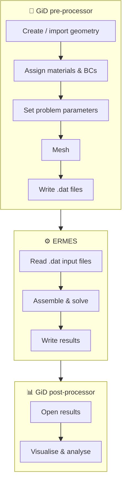

GiD is recommended but not required. Any pre-processor can be used as long as it writes the `.dat` input files in the format defined by the `.bas` templates in `ERMES_20.0.5/ERMES.gid`. Those `.dat` files can also be edited directly for parametric batch runs.

---

<a id="gallery"></a>

## 🖼️ Gallery

<p align="center">
  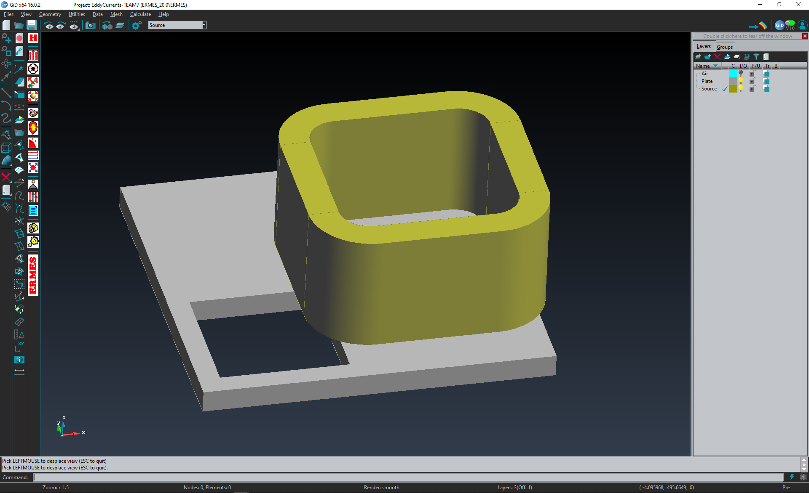<br/>
  <sub>ERMES GiD interface with CAD geometry of a coil and conductive plate (TEAM problem 7)</sub>
</p>

<p align="center">
  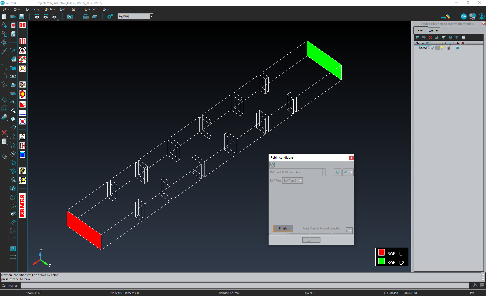<br/>
  <sub>ERMES GiD interface showing the rectangular waveguide ports applied to a microwave filter</sub>
</p>

<p align="center">
  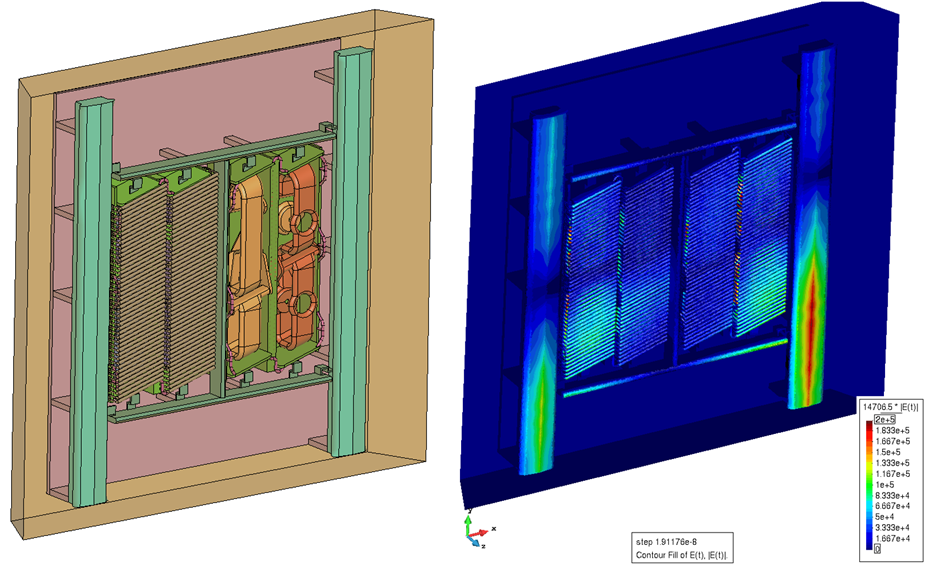<br/>
  <sub>Electric field generated by the JET A2 antenna</sub>
</p>

<p align="center">
  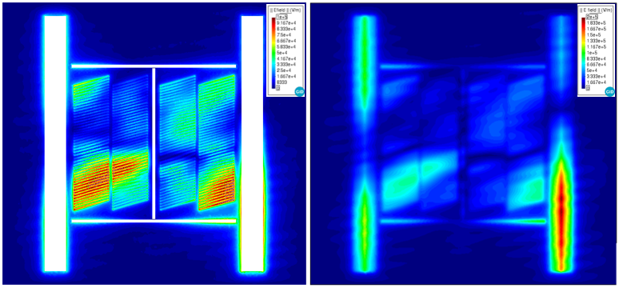<br/>
  <sub>Cut planes of the electric field generated by the JET A2 antenna</sub>
</p>

<p align="center">
  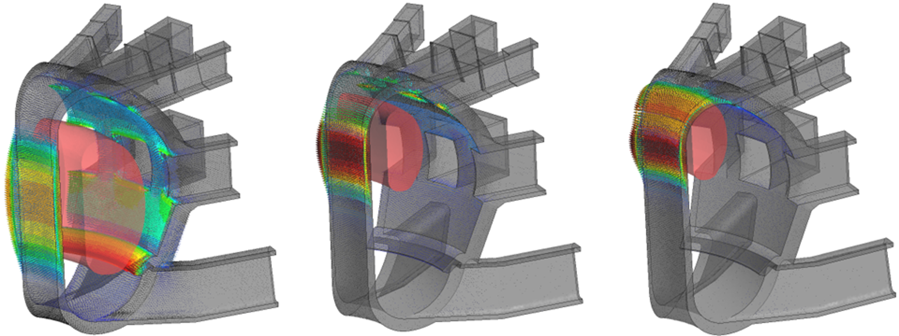<br/>
  <sub>Eddy currents induced on ITER walls by plasma disruption</sub>
</p>

<p align="center">
  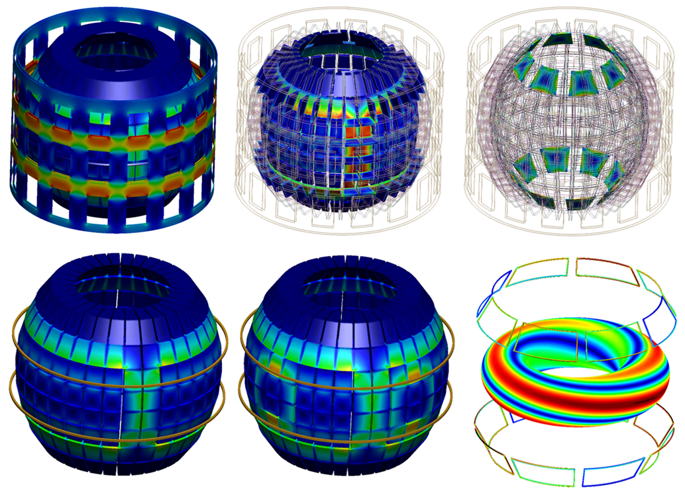<br/>
  <sub>Eddy currents induced on STEP components by plasma and control coils</sub>
</p>

<p align="center">
  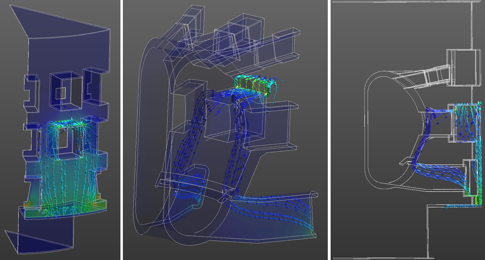<br/>
  <sub>Electric currents following an electric arc strike on ITER components</sub>
</p>

<p align="center">
  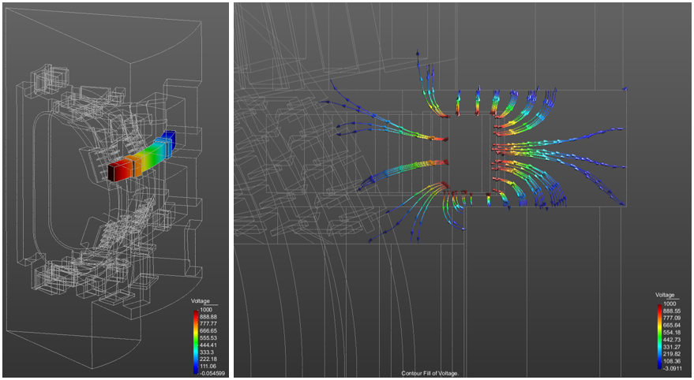<br/>
  <sub>Voltage induced by a quench in a superconducting poloidal coil of ITER</sub>
</p>

<p align="center">
  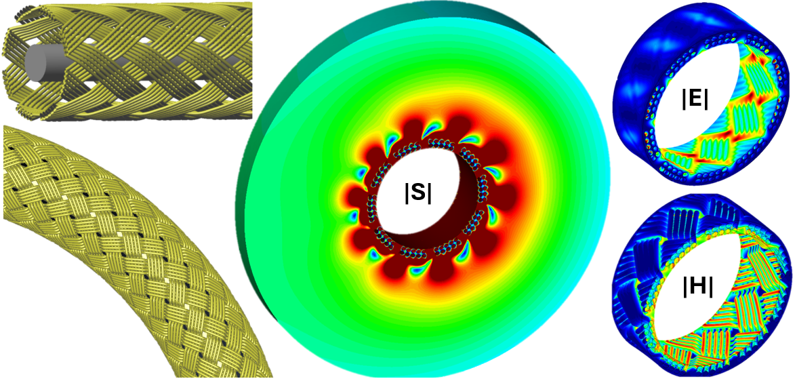<br/>
  <sub>Fields leaking from a coaxial cable braided shield</sub>
</p>

<p align="center">
  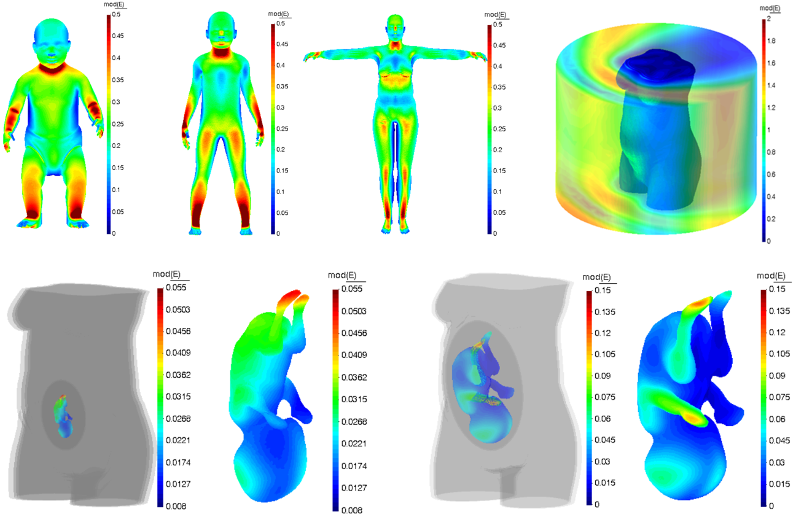<br/>
  <sub>Electric field exposure simulation (EU NextGEM project)</sub>
</p>

---

<a id="documentation"></a>

## 📘 Documentation

The full user manual, `ERMES_20.0.5_Manual.pdf`, covers:

1. **Introduction** — user interface, C++ source code, license
2. **Installation** — GiD, ERMES, PETSc
3. **Pre-process** — geometry, materials, sources, boundary conditions, and problem settings
4. **Post-process** — output files and GiD visualisation
5. **Appendix A** — electromagnetic theory
6. **Appendix B** — finite element formulations

---

<a id="citation"></a>

## 📝 Citation

Publications resulting from the use of ERMES **must cite**:

R. Otin, "ERMES 20.0: Open-source finite element tool for computational electromagnetics in the frequency domain", *Computer Physics Communications*, Vol. 310, 109521, 2025.

```bibtex
@article{Otin2025ERMES,
  author  = {R. Otin},
  title   = {{ERMES} 20.0: Open-source finite element tool for computational
             electromagnetics in the frequency domain},
  journal = {Computer Physics Communications},
  volume  = {310},
  pages   = {109521},
  year    = {2025}
}
```

---

<a id="publications"></a>

## 📚 Publications, conferences and projects

Works on ERMES, computational electromagnetics and nuclear fusion engineering. The up-to-date lists are on the blog: [Articles](https://ruben-otin.blogspot.com/2016/08/ruben-otin-articles-ruben-otin-april-19.html) · [Conferences](https://ruben-otin.blogspot.com/2016/08/ruben-otin-conferences-ruben-otin-april.html) · [Projects](https://ruben-otin.blogspot.com/2015/04/ruben-otin-projects-ruben-otin-april-19.html).

<details>
<summary><b>📄 Journal articles and proceedings</b></summary>

- **Validation of ERMES 20.0 finite element code for MAST Upgrade O-X mode conversion**<br/>R. Otin, Y. H. M. Liang, T. Wilson, S. Freethy, and V. Hall-Chen<br/>*EPJ Web of Conferences*, Vol. 346, 01009, 2026<br/>[EPJ](https://doi.org/10.1051/epjconf/202634601009) · [Preprint](https://drive.google.com/file/d/1N0Zf3oTgXTkADbEzCY2GzeThv52EstIR/view?usp=sharing)
- **Validation of ERMES 20.0 finite element code for JET A2 antennas coupling studies**<br/>R. Otin, D. Milanesio, P. Jacquet, and I. Monakhov<br/>*EPJ Web of Conferences*, Vol. 346, 01027, 2026<br/>[EPJ](https://doi.org/10.1051/epjconf/202634601027) · [Preprint](https://drive.google.com/file/d/1UppppNAPg_J7Vbl4AkQQTbwac78koSHE/view?usp=sharing)
- **Computational human skin model for 5G electromagnetic field exposure studies**<br/>R. Otin, E. Soudah, G. Chirico, F. Schettino, and N. Betzalel<br/>*2025 IEEE International Workshop on Electromagnetics: Applications and Student Innovation Competition (iWEM)*, pp. 41-44, 2025<br/>[IEEE](https://ieeexplore.ieee.org/document/11168062) · [Preprint](https://drive.google.com/file/d/19Cq_khda0e2DBl_LnVmrdm8UqQypRwv8/view?usp=sharing)
- **ERMES 20.0: Open-source finite element tool for computational electromagnetics in the frequency domain**<br/>R. Otin<br/>*Computer Physics Communications*, Vol. 310, 109521, 2025<br/>[CPC](https://doi.org/10.1016/j.cpc.2025.109521) · [Preprint](https://drive.google.com/file/d/1VNLK9ky3IptY8AlUxrfNAY0pUonhGPGv/view?usp=drive_link)
- **Controlling a new plasma regime**<br/>M. Lennholm, S. Aleiferis, S. Bakes, O. P. Bardsley, M. van Berkel, F. J. Casson, F. Chaudry, N. J. Conway, T. C. Hender, S. S. Henderson, B. Kool, M. Lafferty, H. F. Meyer, J. Mitchell, A. Mitra, R. Osawa, R. Otin, A. Parrot, T. Thompson, G. Xia, and the STEP Team<br/>*Philosophical Transactions of the Royal Society A*, Vol. 382, 20230403, 2024<br/>[PTRS](https://doi.org/10.1098/rsta.2023.0403)
- **Plasma control for the STEP prototype power plant**<br/>M. Lennholm, S. Aleiferis, S. Bakes, O. P. Bardsley, M. van Berkel, F. J. Casson, F. Chaudry, N. J. Conway, T. C. Hender, S. S. Henderson, A. Hudoba, B. Kool, M. Lafferty, H. Meyer, J. Mitchell, A. Mitra, R. Osawa, R. Otin, A. Parrott, T. Thompson, G. Xia, and the STEP Team<br/>*Nuclear Fusion*, Vol. 64, 096036, 2024<br/>[NF](https://iopscience.iop.org/article/10.1088/1741-4326/ad6012)
- **ICRH-related impurity source and control across experiments in H, D, T plasmas at JET-ILW**<br/>A. Chomiczewska, W. Gromelski, I. Ivanova-Stanik, ..., R. Otin, ..., E. Delabie, B. Lomanowski, and JET Contributors<br/>*Nuclear Fusion*, Vol. 64, 076058, 2024<br/>[NF](https://iopscience.iop.org/article/10.1088/1741-4326/ad5369)
- **Overview of the EUROfusion Tokamak Exploitation programme in support of ITER and DEMO**<br/>E. Joffrin et al.<br/>*Nuclear Fusion*, Vol. 64, 112019, 2024<br/>[NF](https://iopscience.iop.org/article/10.1088/1741-4326/ad2be4)
- **Overview of T and D–T results in JET with ITER-like wall**<br/>C. F. Maggi et al.<br/>*Nuclear Fusion*, Vol. 64, 112012, 2024<br/>[NF](https://iopscience.iop.org/article/10.1088/1741-4326/ad3e16)
- **RF power as key contributor to high performance "baseline" scenario experiments in JET DD and DT plasmas in preparation for ITER**<br/>D. Van Eester, D. Frigione, L. Garzotti, ..., R. Otin, ..., JET contributors, and EUROfusion-IM team<br/>*AIP Conference Proceedings*, Vol. 2984, 030004, 2023<br/>[AIP](https://doi.org/10.1063/5.0162425)
- **ICRH operations and experiments during the JET-ILW tritium and DTE2 campaigns**<br/>P. Jacquet, E. Lerche, M. Mantsinen, ..., R. Otin, ..., T. Wauters, and JET contributors<br/>*AIP Conference Proceedings*, Vol. 2984, 030003, 2023<br/>[AIP](https://doi.org/10.1063/5.0162645)
- **Remote infrared view of JET divertor compatible with D-T operations**<br/>I. Balboa, E. Rose, G. F. Matthews, ..., R. Otin, J. Naish, V. K. Thompson, and JET Contributors<br/>*Plasma Physics and Controlled Fusion*, Vol. 65 (9), 094002, 2023<br/>[PPCF](https://iopscience.iop.org/article/10.1088/1361-6587/ace6d3)
- **NextGEM: Next-Generation Integrated Sensing and Analytical System for Monitoring and Assessing Radiofrequency Electromagnetic Field Exposure and Health**<br/>N. Petroulakis, M.-O. Mattsson, P. Chatziadam, ..., E. Soudah, R. Otin, F. Schettino, ..., D. Baaken, and A. Bogdanova<br/>*International Journal of Environmental Research and Public Health*, Vol. 20 (12), 6085, 2023<br/>[IJERPH](https://doi.org/10.3390/ijerph20126085)
- **Remote wide angle view broad wavelength viewing system compatible with D-T operations in JET**<br/>I. Balboa, E. Rose, G. F. Matthews, ..., R. Otin, J. Naish, V. K. Thompson, and JET Contributors<br/>*Plasma Physics and Controlled Fusion*, Vol. 65 (6), 064005, 2023<br/>[PPCF](https://iopscience.iop.org/article/10.1088/1361-6587/accecc)
- **Overview of JET results for optimising ITER operation**<br/>J. Mailloux et al.<br/>*Nuclear Fusion*, Vol. 62 (4), 042026, 2022<br/>[NF](https://iopscience.iop.org/article/10.1088/1741-4326/ac47b4/meta)
- **Enabling validated exascale nuclear science**<br/>A. Davis, A. Dubas, and R. Otin<br/>*EPJ Web of Conferences*, Vol. 245, 09001, 2020<br/>[EPJ](https://doi.org/10.1051/epjconf/202024509001)
- **Full wave simulation of RF waves in cold plasma with the stabilized open-source finite element tool ERMES**<br/>R. Otin, W. Tierens, F. Parra, S. Aria, E. Lerche, P. Jacquet, I. Monakhov, P. Dumortier, B. Van Compernolle, and JET Contributors<br/>*AIP Conference Proceedings*, Vol. 2254, 050009, 2020<br/>[AIP](https://aip.scitation.org/doi/pdf/10.1063/5.0013549)
- **Recent improvements to the ICRF antenna coupling code RAPLICASOL**<br/>W. Tierens, G. Suarez-Lopez, R. Otin, G. Urbanczyk, L. Colas, R. Bilato, W. Zhang, V. Bobkov, and J.-M. Noterdaeme<br/>*AIP Conference Proceedings*, Vol. 2254, 070005, 2020<br/>[AIP](https://aip.scitation.org/doi/pdf/10.1063/5.0013518)
- **Computational electromagnetics for nuclear fusion engineering and design**<br/>R. Otin, S. Aria, V. Thompson, R. Lobel, J. Willians, Z. Vizvary, D. Iglesias, and M. Porton<br/>*NAFEMS Benchmark Magazine*, January 2020<br/>[NAFEMS](https://www.nafems.org/publications/benchmark-magazine/archive/january-2020/) · [Preprint](https://drive.google.com/open?id=1FpqJorsWQgbGmYFJYSjliRmUhPvNQp6M)
- **Fault analysis and improved design of JET in-vessel Mirnov coils**<br/>M. Baruzzo, G. Artaserse, R. B. Henriques, S. Gerasimov, N. Lam, P. J. Lomas, R. Otin, F. Rimini, M. Tsalas, S. Van Boxel, and JET Contributors<br/>*Fusion Engineering and Design*, Vol. 150, 110863, 2020<br/>[FEAD](https://www.sciencedirect.com/science/article/pii/S0920379619303059)
- **Overview of the JET preparation for deuterium–tritium operation with the ITER like-wall**<br/>E. Joffrin et al.<br/>*Nuclear Fusion*, Vol. 59 (11), pp. 1-25, 2019<br/>[IOP](https://iopscience.iop.org/article/10.1088/1741-4326/ab2276)
- **Testing of a high temperature radiatively cooled Li/Ta heat pipe in Magnum-PSI**<br/>G. F. Matthews, R. E. Nygren, T. W. Morgan, S. A. Silburn, P. R. Cooper, R. Otin, A. Tallarigo, and the Magnum-PSI Team<br/>*Fusion Engineering and Design*, Vol. 146 (A), pp. 482-485, 2019<br/>[FEAD](https://www.sciencedirect.com/science/article/pii/S0920379618308627)
- **Overview of the JET results in support to ITER**<br/>X. Litaudon et al.<br/>*Nuclear Fusion*, Vol. 57 (10), pp. 1-41, 2017<br/>[IOP](http://iopscience.iop.org/article/10.1088/1741-4326/aa5e28)
- **A finite element tool for the electromagnetic analysis of braided cable shields**<br/>R. Otin, J. Verpoorte, H. Schippers, and R. Isanta<br/>*Computer Physics Communications*, Vol. 191 (1), pp. 209-220, 2015<br/>[CPC](http://dx.doi.org/10.1016/j.cpc.2015.02.007) · [Preprint](https://drive.google.com/open?id=0B4Eur-MHBhw2Z3lfNmJXUWgzb1k)
- **A frequency domain approach for computing the Lorentz force in electromagnetic metal forming**<br/>R. Otin, R. Mendez, and O. Fruitos<br/>*International Journal of Applied Electromagnetics and Mechanics*, Vol. 46 (1), pp. 125-142, 2014<br/>[IJAEM](https://content.iospress.com/articles/international-journal-of-applied-electromagnetics-and-mechanics/jae01766) · [Preprint](https://drive.google.com/open?id=0B4Eur-MHBhw2UVljYlNGU2VTTEU)
- **ERMES: A nodal-based finite element code for electromagnetic simulations in frequency domain**<br/>R. Otin<br/>*Computer Physics Communications*, Vol. 184 (11), pp. 2588-2595, 2013<br/>[CPC](http://www.sciencedirect.com/science/article/pii/S001046551300204X) · [Preprint](https://drive.google.com/open?id=0B4Eur-MHBhw2UHNPY29WbkNqQmc)
- **A numerical model for the search of the optimum frequency in electromagnetic metal forming**<br/>R. Otin<br/>*International Journal of Solids and Structures*, Vol. 50 (10), pp. 1605-1612, 2013<br/>[IJSS](http://www.sciencedirect.com/science/article/pii/S0020768313000383) · [Preprint](https://drive.google.com/open?id=0B4Eur-MHBhw2ZlBYamxtUXBvUVU)
- **Computational performance of a weighted regularized Maxwell equation finite element formulation**<br/>R. Otin, L. E. García-Castillo, I. Martínez-Fernández, and D. García-Doñoro<br/>*Progress In Electromagnetics Research*, Vol. 136, pp. 61-77, 2013<br/>[PIER](http://www.jpier.org/PIER/pier.php?paper=12082005)
- **Specific absorption rate computations with a nodal-based finite element formulation**<br/>R. Otin and H. Gromat<br/>*Progress In Electromagnetics Research*, Vol. 128, pp. 399-418, 2012<br/>[PIER](http://www.jpier.org/PIER/pier.php?paper=12041105)
- **Numerical study of the thermal effects induced by a RFID antenna in vials of blood plasma**<br/>R. Otin<br/>*Progress In Electromagnetics Research Letters*, Vol. 22, pp. 129-138, 2011<br/>[PIERL](http://www.jpier.org/PIERL/pier.php?paper=11021002) · [Preprint](https://drive.google.com/open?id=0B4Eur-MHBhw2TTJwWXZRRFd5SUE)
- **A finite element model for the computation of the transfer impedance of cable shields**<br/>R. Otin, J. Verpoorte, and H. Schippers<br/>*IEEE Transactions on Electromagnetic Compatibility*, Vol. 53 (4), pp. 950-958, 2011<br/>[IEEE](https://ieeexplore.ieee.org/document/5773080) · [Preprint](https://drive.google.com/open?id=0B4Eur-MHBhw2aFlDMk1yREJoMjQ)
- **A numerical model for the search of the optimum capacitance in electromagnetic metal forming**<br/>R. Otin, R. Mendez, and O. Fruitos<br/>*AIP Conference Proceedings*, Vol. 1383, 935, 2011<br/>[AIP](https://aip.scitation.org/doi/abs/10.1063/1.3623705) · [Preprint](https://drive.google.com/open?id=0B4Eur-MHBhw2aE9MeWE1VlhuYUk)
- **Electromagnetic analysis of metal braids**<br/>H. Schippers, J. Verpoorte, and R. Otin<br/>*IEEE 10th International Symposium on Electromagnetic Compatibility*, pp. 543-548, 2011<br/>[IEEE](http://ieeexplore.ieee.org/stamp/stamp.jsp?tp=&arnumber=6078613&isnumber=6078493) · [Preprint](https://drive.google.com/open?id=0B4Eur-MHBhw2aWhJT3NSbUVxUEk)
- **Regularized Maxwell equations and nodal finite elements for electromagnetic field computations**<br/>R. Otin<br/>*Electromagnetics*, Vol. 30 (1-2), pp. 190-204, 2010<br/>[EM](http://www.tandfonline.com/doi/abs/10.1080/02726340903485489) · [Preprint](https://drive.google.com/open?id=0B4Eur-MHBhw2cGs5YXVFMVVQbmM)
- **Open tools for electromagnetic simulation programs**<br/>J. Mora, R. Otin, P. Dadvand, E. Escolano, M. A. Pasenau, and E. Oñate<br/>*The International Journal for Computation and Mathematics in Electrical and Electronic Engineering (COMPEL)*, Vol. 25 (3), pp. 551-564, 2006<br/>[COMPEL](https://doi.org/10.1108/03321640610666709)
- **EMANT: integration of GiD and Kratos, open and flexible computational tools**<br/>R. Otin, J. Mora, and E. Oñate<br/>*IEEE/ACES International Conference on Wireless Communications and Applied Computational Electromagnetics*, pp. 883-886, 2005<br/>[IEEE](http://ieeexplore.ieee.org/stamp/stamp.jsp?tp=&arnumber=1469725&isnumber=31518) · [Preprint](https://drive.google.com/file/d/1FdyJNrFOyXS0vTXCOesxX7--iU-D1enx/view?usp=sharing)

**🎓 Ph.D. thesis**

- **Regularized Maxwell equations and nodal finite elements for electromagnetic field computations in frequency domain**<br/>R. Otin<br/>ISBN 978-84-89925-03-8, Ed. CIMNE, Barcelona (Spain), 2011<br/>[PDF](https://drive.google.com/open?id=0B4Eur-MHBhw2ajJFR2JhRkJiMG8)

</details>

<details>
<summary><b>🎤 Conferences</b></summary>

- **Full-wave FEM modelling of the MAST-U EBW microwave heating and current drive system and comparison with experiments and numerical approaches**<br/>R. Otin, S. Freethy, J. Allen, T. Wilson, C. Hopkins, and A. K. Seemann<br/>*23rd Workshop on Electron Cyclotron Emission and Electron Cyclotron Resonance Heating (EC-23)*, Barcelona (Spain), May 18-22, 2026<br/>[Poster](https://drive.google.com/file/d/1bxEtDBvfkRX2TuvjKUydgYqBiIvsqi7D/view?usp=sharing)
- **An open-source finite element tool for electromagnetic analysis and design**<br/>R. Otin and E. Soudah<br/>*XL National Symposium of the International Union of Radio Science (URSI 2025)*, Tarragona (Spain), September 3-5, 2025<br/>[Paper](https://drive.google.com/file/d/1W9kp8c3y3SeqF2yiS9ty2EL4twzWfgdt/view?usp=sharing)
- **Computational human skin model for 5G electromagnetic field exposure studies**<br/>R. Otin, E. Soudah, G. Chirico, F. Schettino, and N. Betzalel<br/>*2025 IEEE International Workshop on Electromagnetics: Applications and Student Innovation Competition (iWEM 2025)*, Hong Kong (SAR PRC), August 4-6, 2025<br/>[Poster](https://drive.google.com/file/d/1H3wCzLz5SCkJKKz63svNYNSAvQCYo5LW/view?usp=sharing) · [Paper](https://drive.google.com/file/d/19Cq_khda0e2DBl_LnVmrdm8UqQypRwv8/view?usp=sharing)
- **Validation of ERMES 20.0 finite element code for MAST Upgrade O-X mode conversion**<br/>R. Otin, Y. H. M. Liang, T. Wilson, S. Freethy, and V. Hall-Chen<br/>*The 25th Topical Conference on Radiofrequency Power in Plasmas (RFPPC 2025)*, Schloss Hohenkammer (Germany), May 19-22, 2025<br/>[Poster](https://drive.google.com/file/d/12Ulg68uNnxZ1scWS2AMUoZ7nWyhBbJhg/view?usp=sharing) · [Paper](https://drive.google.com/file/d/1N0Zf3oTgXTkADbEzCY2GzeThv52EstIR/view?usp=sharing)
- **Validation of ERMES 20.0 finite element code for JET A2 antennas coupling studies**<br/>R. Otin, D. Milanesio, P. Jacquet, and I. Monakhov<br/>*The 25th Topical Conference on Radiofrequency Power in Plasmas (RFPPC 2025)*, Schloss Hohenkammer (Germany), May 19-22, 2025<br/>[Poster](https://drive.google.com/file/d/1hMgFPGA8yK3iIWRWsIPJFKO6mFrXBqXb/view?usp=sharing) · [Paper](https://drive.google.com/file/d/1UppppNAPg_J7Vbl4AkQQTbwac78koSHE/view?usp=sharing)
- **Plasma control system design and disruption forces modelling with the open-source platform ERMES**<br/>R. Otin, T. C. Hender, G. Xia, O. Bardsley, and J. Paterson<br/>*The 65th Annual Meeting of the APS Division of Plasma Physics*, Denver (Colorado, USA), October 30-November 3, 2023<br/>[Poster](https://drive.google.com/file/d/1m_Zld4ilY0jp_AB4f-2-Epnrs9-TMSwL/view?usp=sharing)
- **Plasma-wave interaction modelling in magnetic confined devices with the finite element method**<br/>R. Otin, G. Urbanczyk, and W. Tierens<br/>*The 64th Annual Meeting of the APS Division of Plasma Physics*, Spokane (Washington, USA), October 17-21, 2022<br/>[Abstract](https://drive.google.com/file/d/1VvuX8j2mduwtIzYEKUIfDoFxTaFBUQQ9/view?usp=share_link)
- **RF power as key contributor to high performance "baseline" scenario experiments in JET DD and DT plasmas in preparation for ITER**<br/>D. Van Eester, D. Frigione, L. Garzotti, ..., R. Otin, ..., JET contributors, and EUROfusion-IM team<br/>*The 24th Topical Conference on Radiofrequency Power in Plasmas (RFPPC 2022)*, Annapolis (Maryland, USA), September 26-28, 2022<br/>[Paper](https://doi.org/10.1063/5.0162425)
- **ICRH operations and experiments during the JET-ILW tritium and DTE2 campaign**<br/>P. Jacquet, E. Lerche, M. Mantsinen, ..., R. Otin, ..., M. Valisa, and JET Contributors<br/>*The 24th Topical Conference on Radiofrequency Power in Plasmas (RFPPC 2022)*, Annapolis (Maryland, USA), September 26-28, 2022<br/>[Paper](https://doi.org/10.1063/5.0162645)
- **A new E-field finite element formulation for the numerical modelling of high temperature superconductors**<br/>R. Otin, S. Aria, Z. Heng, A. Dubas, A. Davis, and F. Schoofs<br/>*The 7th International Workshop on Numerical Modelling of High Temperature Superconductors*, Virtual Meeting, June 22-23, 2021<br/>[Poster](https://drive.google.com/file/d/1Qm9NuzHMwwkHJPMFFi7kpc9Pk2Rpspjn/view?usp=sharing)
- **Modeling of quench arcing in ITER superconducting magnets**<br/>S. Tippetts, A. Verweij, M. Maciejewski, S. Zheng, N. Mitchell, E. Gaxiola, S. Mcintosh, P. Bauer, E. Surrey, A. Holmes, H. Zhang, R. Otin, R. Qingxiang, and X. Huang<br/>*Technology of Fusion Energy (TOFE 2020)*, Virtual Meeting, November 16-19, 2020<br/>[Abstract](https://www.ans.org/meetings/wm2020/session/view-354/#paper_783)
- **Enabling validated exascale nuclear science**<br/>A. Davis, A. Dubas, and R. Otin<br/>*The 24th International Conference on Computing in High Energy and Nuclear Physics (CHEP 2019)*, Adelaide (Australia), November 4-8, 2019<br/>[Abstract](https://www.epj-conferences.org/articles/epjconf/abs/2020/21/epjconf_chep2020_09001/epjconf_chep2020_09001.html)
- **An ANSYS-based model for arcs in large superconducting magnets**<br/>S. Tippetts, R. Otin, H. Zhang, A. Holmes, S. Mcintosh, P. Bauer, N. Mitchell, A. Verweij, M. Maciejewski, E. Surrey, and S. Zheng<br/>*The 14th European Conference on Applied Superconductivity (EUCAS 2019)*, Glasgow (United Kingdom), September 1-5, 2019<br/>[Abstract](https://drive.google.com/open?id=1yP1BhVzRLGCBK8olmY_ic4hdk8CaK0fy)
- **A PSpice-based electric circuit model for arcs in large superconducting magnets**<br/>H. Zhang, S. Tippetts, R. Otin, A. Holmes, S. Mcintosh, P. Bauer, N. Mitchell, A. Verweij, M. Maciejewski, H. Lux, E. Surrey, and S. Zheng<br/>*The 14th European Conference on Applied Superconductivity (EUCAS 2019)*, Glasgow (United Kingdom), September 1-5, 2019<br/>[Abstract](https://drive.google.com/open?id=1AH49SpNM9mlZXdfc5-Teq0OpPW2GByla)
- **Computational electromagnetics for nuclear fusion engineering and design**<br/>R. Otin, S. Aria, V. Thompson, R. Lobel, J. Willians, Z. Vizvary, D. Iglesias, and M. Porton<br/>*NAFEMS World Congress 2019*, Quebec City (Canada), June 17-20, 2019<br/>[Paper](https://drive.google.com/open?id=1FpqJorsWQgbGmYFJYSjliRmUhPvNQp6M)
- **Full wave simulation of RF waves in cold plasma with the stabilized open-source finite element tool ERMES**<br/>R. Otin, W. Tierens, F. Parra, S. Aria, E. Lerche, P. Jacquet, I. Monakhov, P. Dumortier, B. Van Compernolle, and JET Contributors<br/>*The 23rd Topical Conference on Radiofrequency Power in Plasmas (RFPPC 2019)*, Hefei (China), May 14-17, 2019<br/>[Poster](https://drive.google.com/open?id=1D0vsH6oB_Rl94JSKGohaL-XKSq4iQ3Hm) · [Paper](https://drive.google.com/open?id=1x8F6EUkc83x26LggZOZ56yBrCJtkukXK)
- **Recent improvements to the ICRF antenna coupling code RAPLICASOL**<br/>W. Tierens, G. Suarez-Lopez, R. Otin, G. Urbanczyk, L. Colas, R. Bilato, W. Zhang, V. Bobkov, and J.-M. Noterdaeme<br/>*The 23rd Topical Conference on Radiofrequency Power in Plasmas (RFPPC 2019)*, Hefei (China), May 14-17, 2019<br/>[Poster](https://drive.google.com/open?id=1D0xo2D9GKnIDCiG7X7_lOQiERcrsYhR6) · [Paper](https://drive.google.com/open?id=1r0TyFmCKaPCyYaIsbKjTJrzwuvE8utjq)
- **Advances in predictive thermo-mechanical modelling for the JET divertor experimental interpretation, improved protection, and reliable operation**<br/>D. Iglesias, W. Arter, I. Balboa, ..., V. Thompson, R. Otin, D. F. Valcarcel, ..., J. Williams, and JET Contributors<br/>*27th IAEA Fusion Energy Conference (FEC 2018)*, Gandhinagar (India), October 22–27, 2018<br/>[Abstract](https://www.iaea.org/sites/default/files/18/10/cn-258-abstracts.pdf)
- **Fault analysis and improved design of JET in-vessel Mirnov coils**<br/>M. Baruzzo, G. Artaserse, R. B. Henriques, S. Gerasimov, N. Lam, P. J. Lomas, R. Otin, F. Rimini, M. Tsalas, S. Van Boxel, and JET Contributors<br/>*30th Symposium on Fusion Technology (SOFT 2018)*, Sicily (Italy), September 16-21, 2018<br/>[Abstract](https://www.soft2018.eu/?download=_/programme/book_of_abs_v3.pdf)
- **Testing of a high temperature radiatively cooled Li/Ta heat pipe in Magnum-PSI**<br/>G. F. Matthews, R. E. Nygren, T. W. Morgan, S. A. Silburn, R. Otin, A. Tallarigo, and the Magnum-PSI team<br/>*30th Symposium on Fusion Technology (SOFT 2018)*, Sicily (Italy), September 16-21, 2018<br/>[Abstract](https://www.soft2018.eu/?download=_/programme/book_of_abs_v3.pdf)
- **Electromagnetic field exposure assessment of TIG-AC and CD stud welding in accordance with the EU Directive 2013/35/EU**<br/>R. Otin and R. Salmon<br/>*The 70th International Institute of Welding Annual Assembly and International Conference*, Shanghai (P. R. China), June 25-30, 2017<br/>[Paper](https://drive.google.com/open?id=0B4Eur-MHBhw2Rm1MRDhJQy13ZlU)
- **A finite element and massively parallel code for the multi-physics simulation of high temperature superconducting devices**<br/>R. Otin, A. F. Martin, and S. Badia<br/>*4th International Workshop on Numerical Modelling of High Temperature Superconductors (HTS modelling 2014)*, Bratislava (Slovakia), May 11-14, 2014<br/>[Abstract](https://drive.google.com/open?id=0B4Eur-MHBhw2UHIwUUoxcVBoWGs)
- **A finite element code for solving the regularized Maxwell equations in engineering applications**<br/>R. Otin<br/>*IFIP TC7.2 Workshop on Electromagnetics - Modelling, Simulation, Control and Industrial Applications*, Berlin (Germany), May 13-17, 2013<br/>[Abstract](https://drive.google.com/open?id=0B4Eur-MHBhw2S2hDX09uN1BONzA)
- **Comparative performance of nodal-based versus edge-based finite element formulations**<br/>R. Otin, S. Badia, and L. E. Garcia-Castillo<br/>*The 11th International Workshop on Finite Elements for Microwave Engineering (FEM 2012)*, Estes Park (Colorado, USA), June 4-6, 2012<br/>[Abstract](https://drive.google.com/open?id=0B4Eur-MHBhw2djNvSmFUYl9IX3M)
- **Finite element modelling of braided wire shields**<br/>R. Otin<br/>*The 10th International Symposium and Exhibition on Electromagnetic Compatibility (EMC Europe 2011)*, York (United Kingdom), September 26-30, 2011<br/>[Abstract](https://drive.google.com/open?id=0B4Eur-MHBhw2UzdIempSNXNMdXc)
- **Electromagnetic analysis of metal braids**<br/>H. Schippers, J. Verpoorte, and R. Otin<br/>*The 10th International Symposium and Exhibition on Electromagnetic Compatibility (EMC Europe 2011)*, York (United Kingdom), September 26-30, 2011<br/>[Paper](https://drive.google.com/open?id=0B4Eur-MHBhw2aWhJT3NSbUVxUEk)
- **A numerical model for the search of the optimum capacitance in electromagnetic metal forming**<br/>R. Otin, R. Mendez, and O. Fruitos<br/>*The 8th International Conference and Workshop on Numerical Simulation of 3D Sheet Metal Forming Processes (NUMISHEET 2011)*, Seoul (Republic of Korea), August 21-26, 2011<br/>[Paper](https://drive.google.com/open?id=0B4Eur-MHBhw2aE9MeWE1VlhuYUk)
- **Electromagnetic analysis of metal braids**<br/>H. Schippers, J. Verpoorte, and R. Otin<br/>*The 9th International Symposium on EMC joint with the 20th International Wroclaw Symposium on EMC (EMC Europe 2010)*, Wroclaw (Poland), September 13-17, 2010
- **GiD interface for the parametric generation of simplified braided-wire shields geometries**<br/>O. Fruitos, R. Isanta, R. Otin, and R. Mendez<br/>*The 5th Conference on Advances and Applications of GiD*, Barcelona (Spain), May 26-27, 2010<br/>[Paper](https://drive.google.com/open?id=0B4Eur-MHBhw2MzBzWDRPSzBmbGM)
- **Multiphysics simulation of metal sheet electromagnetic forming**<br/>O. Fruitos, R. Otin, R. Mendez, and J. Llumà<br/>*The 10th International Conference on Computational Plasticity, Fundamentals and Applications (COMPLAS X)*, Barcelona (Spain), September 2-4, 2009
- **Regularized Maxwell equations with nodal elements as an alternative approach to the edge-based FEM formulations**<br/>R. Otin<br/>*The 9th International Workshop on Finite Elements for Microwave Engineering (FEM 2008)*, Bonn (Germany), May 8-9, 2008<br/>[Abstract](https://drive.google.com/open?id=0B4Eur-MHBhw2U2tRTEFpQm80S0U)
- **A high-order nodal finite element formulation for microwave engineering**<br/>R. Otin<br/>*The 24th International Review of Progress in Applied Computational Electromagnetics (ACES 2008)*, Niagara Falls (Canada), March 30-April 4, 2008<br/>[Paper](https://drive.google.com/open?id=0B4Eur-MHBhw2Ui1vUHlyY0NiYm8)
- **El método de los elementos finitos aplicado a las ecuaciones de Maxwell regularizadas en presencia de singularidades**<br/>R. Otin and J. Mora<br/>*V Encuentro Ibérico de Electromagnetismo Computacional*, Aiguablava (Spain), April 25-27, 2007
- **Open tools for electromagnetic simulation programs**<br/>J. Mora, R. Otin, P. Dadvand, E. Escolano, M. A. Pasenau, and E. Oñate<br/>*International Symposium on Electromagnetic Fields in Mechatronics, Electrical and Electronic Engineering (ISEF 2005)*, Baiona (Spain), September 15-17, 2005
- **EMANT: integration of GiD and Kratos, open and flexible computational tools**<br/>R. Otin, J. Mora, and E. Oñate<br/>*IEEE/ACES International Conference on Wireless Communications and Applied Computational Electromagnetics*, Honolulu (Hawaii, USA), April 3-7, 2005<br/>[Paper](https://drive.google.com/file/d/1FdyJNrFOyXS0vTXCOesxX7--iU-D1enx/view?usp=sharing)

</details>

<details>
<summary><b>🧪 Projects and technical reports</b></summary>

**⚛️ Nuclear fusion engineering**

- **Inverse force reconstruction algorithms for ITER disruption events**<br/>D. Iglesias, R. Otin, and A. Tallarigo<br/>ITER_D_TL9N7R, 2017
- **Impact of DEMO-relevant ferromagnetic bolts on JET performance**<br/>R. Otin, V. K. Thompson, and P. J. Lomas<br/>EAG16-T019, 2016
- **New design proposals for the JET ITER-like antenna electric contacts**<br/>V. K. Thompson and R. Otin<br/>FIVER_ST_1500_D001, 2015
- **Induced electromagnetic loads on rectangular plates in nuclear fusion scenarios**<br/>R. Otin<br/>EAG15-T018, 2015<br/>[Tech report](https://drive.google.com/file/d/1MgoKbisrNDsto4n89bLzHzDiFsZznesh/view?usp=drive_link)
- **Electrical failure analysis of MAST-U P1 coil**<br/>R. Otin, J. Last, and P. Jacquet<br/>EAG15-T015, 2015
- **Fault analysis of JET in-vessel Mirnov coils**<br/>R. Otin, M. Tsalas, and M. Baruzzo<br/>EAG15-T014, 2015
- **Limits of applicability of the induction-less approximation on nuclear fusion scenarios**<br/>R. Otin<br/>EAG14-T015, 2014

**🧬 Bioelectromagnetics**

- **Development of modelling approaches to assess internal and external exposure**<br/>E. Soudah, R. Otin, M. Spirito, F. Schettino, M. D. Migliore, N. Petroulakis, A. Laromaine, P. Alonso, M. Velghe, and Y. Feldman<br/>Project NextGEM HORIZON-HLTH-2021-ENVHLTH-02-01, Deliverable 3.6, September 2024<br/>[NextGEM](https://www.nextgem.eu/)
- **Electromagnetic field exposure assessment of TIG-AC and CD stud welding in accordance with the EU Directive 2013/35/EU**<br/>R. Otin and R. Salmon<br/>EAG17-T004, 2017<br/>[Tech report](https://drive.google.com/open?id=0B4Eur-MHBhw2cUhuU3p1MEJadTQ)
- **ERMES: Numerical tool for SAR computations**<br/>R. Otin<br/>CIMNE IT-584, 2009<br/>[Tech report](https://drive.google.com/open?id=0B4Eur-MHBhw2WEc0RThxQVVlcUE)
- **Numerical study of the thermal effects induced by a RFID antenna in vials of blood plasma**<br/>R. Otin<br/>CIMNE IT-583, 2009<br/>[Tech report](https://drive.google.com/open?id=0B4Eur-MHBhw2NWg3NS1sSVdLc3M)
- **Specific absorption rate computational tool for SMART**<br/>R. Otin<br/>Project SMART ANTENNAS (SMart Antennas system for Radio Transceivers), European Commission, EUREKA PIDEA+ 04-1612005-2008, July 2005 - September 2008<br/>[Poster](https://drive.google.com/open?id=0B4Eur-MHBhw2YUgyQjdxUll3VGs)

**📡 Electromagnetic compatibility**

- **Use of ERMES in quantum computing**<br/>F. Chaudry, R. Otin, R. Macdonald, J. Paterson, and S. Aria<br/>UKAEA KAGF Project 10083751, July 2024
- **Electromagnetic modeling of braided wire shields**<br/>R. Otin, H. Schippers, J. Verpoorte, and R. Isanta<br/>Project HIRF SE (High Intensity Radiated Fields Synthetic Environment), European Commission, FP7 ACP7-GA-2008-205294, December 2008 - May 2013<br/>[Poster](https://drive.google.com/open?id=0B4Eur-MHBhw2ajZrQ1J4cGlFaFE)
- **A CAD tool for the electromagnetic modeling of braided wire shields**<br/>R. Otin and R. Isanta<br/>CIMNE IT-639, 2013<br/>[Tech report](https://drive.google.com/open?id=0B4Eur-MHBhw2Nm12WldpTDJQU2c)
- **Project NET-EMC: Numerical simulation report (CIMNE)**<br/>X. Roca, M. Coma, R. Otin, and J. Mora<br/>CIMNE IT-628, 2012<br/>[Tech report](https://drive.google.com/open?id=0B4Eur-MHBhw2UC1iZjRnbzc1MFk)
- **Interfase GiD per a la generació paramètrica de geometries trenades per a l'apantallament de cables coaxials**<br/>R. Mendez, R. Isanta, R. Otin, and O. Fruitos<br/>CIMNE IT-594, 2009

**🔨 Electromagnetic forming**

- **Electromagnetic metal forming**<br/>R. Otin, R. Mendez, and O. Fruitos<br/>CIMNE IT-618, 2011<br/>[Tech report](https://drive.google.com/open?id=0B4Eur-MHBhw2aVFNRnBlUDZLeU0)
- **Metodología para la simulación de procesos electromagnético-mecánicos acoplados. Simulaciones 3D y validaciones experimentales preliminares**<br/>R. Mendez, A. Ferriz, O. Fruitos, and R. Otin<br/>CIMNE IT-568, 2009
- **Metodología para la simulación de procesos electromagnéticos mecánicos acoplados. Informe de avances**<br/>R. Mendez, A. Ferriz, R. Otin, and O. Fruitos<br/>CIMNE IT-536, 2008

**💻 Software development**

- **ERMES 20.0 user manual**<br/>R. Otin<br/>UKAEA, 2024<br/>[Tech report](https://drive.google.com/file/d/1-fhMH16AB_WM7tILIwHboVMs1uRgUNcm/view?usp=drive_link)
- **Description and user guide of ERMES v7.0**<br/>R. Otin<br/>CIMNE IT-633, 2013<br/>[Tech report](https://drive.google.com/open?id=0B4Eur-MHBhw2TUgtTE5HcHBIR0U)
- **ERMES user guide**<br/>R. Otin<br/>CIMNE IT-617, 2011<br/>[Tech report](https://drive.google.com/open?id=0B4Eur-MHBhw2UUJUN1VPVFJRaEk)
- **Open tools for electromagnetic simulation programs**<br/>J. Mora, R. Otin, P. Dadvand, E. Escolano, M. A. Pasenau, and E. Oñate<br/>CIMNE PI-273, 2005

</details>

---

<a id="license"></a>

## ⚖️ License

ERMES 20.0.5 source code, binaries and interface are released under the **2-clause BSD license**. The executables also contain third-party open-source components ( METIS / GKlib under Apache-2.0, and the compiler runtime libraries ); their licenses are in `ERMES_20.0.5/ERMES.gid/execs/licenses`.

<details>
<summary>Full license text</summary>

```
Copyright (c) 2013 Ruben Otin, CIMNE (International Center for Numerical
Methods in Engineering). All rights reserved.

Redistribution and use in source and binary forms, with or without
modification, are permitted provided that the following conditions are met:

1. Redistributions of source code must retain the above copyright notice,
   this list of conditions and the following disclaimer.

2. Redistributions in binary form must reproduce the above copyright notice,
   this list of conditions and the following disclaimer in the documentation
   and/or other materials provided with the distribution.

THIS SOFTWARE IS PROVIDED BY THE COPYRIGHT HOLDERS AND CONTRIBUTORS "AS IS"
AND ANY EXPRESS OR IMPLIED WARRANTIES, INCLUDING, BUT NOT LIMITED TO, THE
IMPLIED WARRANTIES OF MERCHANTABILITY AND FITNESS FOR A PARTICULAR PURPOSE
ARE DISCLAIMED. IN NO EVENT SHALL THE COPYRIGHT HOLDER OR CONTRIBUTORS BE
LIABLE FOR ANY DIRECT, INDIRECT, INCIDENTAL, SPECIAL, EXEMPLARY, OR
CONSEQUENTIAL DAMAGES (INCLUDING, BUT NOT LIMITED TO, PROCUREMENT OF
SUBSTITUTE GOODS OR SERVICES; LOSS OF USE, DATA, OR PROFITS; OR BUSINESS
INTERRUPTION) HOWEVER CAUSED AND ON ANY THEORY OF LIABILITY, WHETHER IN
CONTRACT, STRICT LIABILITY, OR TORT (INCLUDING NEGLIGENCE OR OTHERWISE)
ARISING IN ANY WAY OUT OF THE USE OF THIS SOFTWARE, EVEN IF ADVISED OF THE
POSSIBILITY OF SUCH DAMAGE.
```

</details>

---

<a id="previous-versions"></a>

## 🗂️ Previous versions

Earlier ERMES versions, including their executables, manuals and examples, remain available at:

- 🌐 [Ruben Otin software page ( blog )](https://ruben-otin.blogspot.com/2015/04/ruben-otin-software-ruben-otin-april-19.html)
- 📁 [ERMES versions archive ( Google Drive )](https://drive.google.com/drive/folders/1Gipqbgu3bHuv8TdSJd-eZ2W2nOFT75kS)

---

<a id="contact"></a>

## 📬 Contact

**Ruben Otin** — United Kingdom Atomic Energy Authority (UKAEA), Oxford, UK

- ✉️ [ruben.otin@ukaea.uk](mailto:ruben.otin@ukaea.uk)
- ✉️ [ruben.otin.bcn@gmail.com](mailto:ruben.otin.bcn@gmail.com)
- 🌐 [ruben-otin.blogspot.com](https://ruben-otin.blogspot.com)

<div align="center">
<sub>ERMES 20.0.5 · October 2026</sub>
</div>
